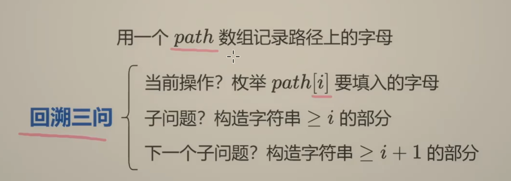

## 200

数组的dfs和二叉树的dfs十分类似。   第一步都是判断边界条件，然后操作递归元素，最后再递归其他元素。

都是从原问题拆成小问题。本题原问题：数岛屿数量；子问题：判断岛屿节点四周是不是岛屿节点。

```java
class Solution {
    public int numIslands(char[][] grid) {
        int res=0;
        int m=grid.length;
        int n=grid[0].length;
        for(int i=0;i<m;i++){
            for(int j=0;j<n;j++){
                if(grid[i][j]=='1'){
                    dfs(grid,i,j);
                    res++;
                }
            }
        }
        return res;

    }

    public void dfs(char[][] grid,int i,int j) {
        if(i<0||j<0||i>=grid.length||j>=grid[0].length||  grid[i][j]=='0'){
            return;
        }
        if(grid[i][j]=='1'){
            grid[i][j]='0';
        }
        dfs(grid,i+1,j);
        dfs(grid,i,j+1);
        dfs(grid,i-1,j);
        dfs(grid,i,j-1);

    }

}
```

## 994

数组的bfs和二叉树一样差不多，不过需要创一个辅助数组来方便bfs左右上下节点。注意队列里只存腐烂的橘子，所以要，然后每遍历一层且fresh > 0的情况下 ans++

```java
class Solution {

    public int orangesRotting(int[][] grid) {
        int ans = 0;
        int fresh = 0;
        int[][] dirs = {{1,0},{-1,0},{0,1},{0,-1}};
        Queue<int[]> queue = new LinkedList<>();
        for(int i = 0;i < grid.length; i++){
            for(int j = 0; j < grid[i].length; j++){
                if(grid[i][j] == 2){
                    queue.offer(new int[]{i,j});
                }
                if(grid[i][j] == 1) fresh++;
            }
        }

        while(!queue.isEmpty() && fresh > 0){
            int n = queue.size();
            ans++;
            for(int i = 0; i < n; i++){
                int[] t = queue.poll();
                for(int[] d : dirs){
                    int k = t[0]+d[0];
                    int j = t[1]+d[1];
                    if(k < 0 || j < 0 || k >= grid.length || j >= grid[k].length || grid[k][j]!= 1) continue;
                    fresh--;
                    grid[k][j] = 2;
                    queue.offer(new int[]{k,j});
                }
            }
        }
        return fresh > 0 ? -1 :ans;
    }


}
```

## 46

这题是要用到回溯的dfs。用一个数组判断nums里的数有没有被用过，然后dfs遍历，最后回溯就完了。排列型回溯

```java
class Solution {
    public List<List<Integer>> permute(int[] nums) {
        int n = nums.length;
        List<Integer> path = Arrays.asList(new Integer[n]);
        List<List<Integer>> res = new ArrayList<>();
        boolean[] onPath = new boolean[n];
        dfs(0, nums, res, path, onPath);
        return res;
    }

    public void dfs(int i, int[] s, List<List<Integer>> res, List<Integer> path, boolean[] onPath){
        if(i == s.length){
            res.add(new ArrayList<Integer>(path));
            return;
        }

        for(int j = 0; j < s.length; j++){
            if(!onPath[j]){
                path.set(i,s[j]);
                onPath[j] = true;
                dfs(i+1, s, res, path, onPath);
                onPath[j] = false;
            }
        }
    }
}
```

注意：   List<Integer> path = Arrays.asList(new Integer[n];是直接给List这么多size，有参构造只是定容量，size= 0。

模板：

```java
void backtrack(路径, 选择列表) {
    if (满足结束条件) { 收集结果; return; }   // ① 终止
    for (选择 : 选择列表) {
        if (已使用[选择]) continue;            // ② 去重
        选择; path.add(选择);
        backtrack(路径, 选择列表);            // ③ 递归
        撤销; path.remove(选择);              // ④ 回溯
    }
}
```

## 78

子集型回溯



#### 方法一：选或不选

只有叶子节点才是结果。

```java
class Solution {
    public List<List<Integer>> subsets(int[] nums) {
        List<List<Integer>> res = new ArrayList<>();
        List<Integer> path  = new ArrayList<>();
        dfs(0, nums, res, path);
        return res;
    }

    public void dfs(int i, int[]nums, List<List<Integer>> res, List<Integer> path){
        if(i == nums.length){
            res.add(new ArrayList<>(path));
            return;
        }
        dfs(i+1, nums, res, path);
        path.add(nums[i]);
        dfs(i+1, nums, res, path);
        path.removeLast();
    }
}
```

#### 方法二：选哪个

每个节点都是结果。

```java
class Solution {
    public List<List<Integer>> subsets(int[] nums) {
        List<List<Integer>> res = new ArrayList<>();
        List<Integer> path  = new ArrayList<>();
        dfs(0, nums, res, path);
        return res;
    }

    public void dfs(int i, int[]nums, List<List<Integer>> res, List<Integer> path){
        res.add(new ArrayList<Integer>(path));
        for(int j = i; j < nums.length; j++){
            path.add(nums[j]);
            dfs(j+1, nums, res, path);
            path.removeLast();
        }
    }
}
```

## 39

组合型回溯

#### 方法一：选哪个

```java
public void dfs(int j, int sum, int[] c, List<List<Integer>> res, List<Integer> path, int target){
    if(sum == target){
        res.add(new ArrayList<>(path));
        return;
    }

    for(int i = j; i < c.length; i++){
        if(sum+c[i] > target) continue;
        path.add(c[i]);
        dfs(i,sum+c[i], c, res, path, target);
        path.removeLast();

    }
}
```

#### 方法二：选或不选

```java
class Solution {
    public List<List<Integer>> combinationSum(int[] candidates, int target) {
        List<List<Integer>> res = new ArrayList<>();
        List<Integer> path  = new ArrayList<>();
        dfs(0 ,target, candidates, res, path);
        return res;
    }

    public void dfs(int j, int left, int[] c, List<List<Integer>> res, List<Integer> path){
        if(left == 0){
            res.add(new ArrayList<>(path));
            return;
        }
        if(j == c.length || left < 0) return;
        dfs(j+1,left,c,res,path);
        path.add(c[j]);
        dfs(j,left-c[j],c,res,path);
        path.remove(path.size()-1);
    }
}
```

#### 大佬做法（1ms ）：orzorz

```java
class Solution {
    public List<List<Integer>> ans = new ArrayList<>();

    public List<List<Integer>> combinationSum(int[] candidates, int target) {
        int n = candidates.length;
        int[] cnt = new int[n];
        dfs(0,n,candidates,cnt,target,0);
        return ans;
    }

    public void dfs(int u,int n,int[] candidates,int[] cnt,int target,int s){
        if(u == n){
            if(s == target){
                List<Integer> res = new ArrayList<>();
                for(int i=0;i<n;i++){
                    for(int j=0;j<cnt[i];j++){
                        res.add(candidates[i]);
                    }
                }
                ans.add(res);
            }
            return;
        }
        for(int i=0;i<=(target-s)/candidates[u];i++){
            cnt[u] = i;
            dfs(u+1,n,candidates,cnt,target,s+i*candidates[u]);
        }//算出这个数可以被取多少次
    }
}
```

## 79

和200有点类似，两个优化方法能0ms秒杀。原问题：word是否存在网格中；子问题：dfs的第i个数是不是等于word[i].

```java
class Solution {
    int[][] DIRS = {{1,0}, {-1,0}, {0,1}, {0,-1}};
    public boolean exist(char[][] board, String word) {
        int[] cnt = new int[128];
        for(char[] s : board){
            for(char s1 : s){
                cnt[s1]++;
            }
        }
        int[] wordcnt = new int[128];
        char[] w = word.toCharArray();
        for(char c : w){
            if(++wordcnt[c] > cnt[c]) return false;
        }

        if(cnt[w[w.length-1]] < cnt[w[0]]){
            w = new StringBuilder(word).reverse().toString().toCharArray();
        }
        for(int i = 0; i < board.length; i++){
            for(int j = 0; j < board[i].length; j++){
                if(dfs(i,j,w,board,0)) return true;
            }
        }
        return false;
    }

    public boolean dfs(int i, int j, char[] word, char[][] board, int k){
        if(board[i][j] != word[k]) return false;
        if(k == word.length-1) return true;

        board[i][j] = 0;
        for(int[] d : DIRS){
            int x = i + d[0];
            int y = j + d[1];
            if(x>=0 && x<board.length && y>=0 && y<board[i].length && dfs(x,y,word,board,k+1)){
                return true;
            }
        }
        board[i][j] = word[k];
        return false;
    }
}
```
